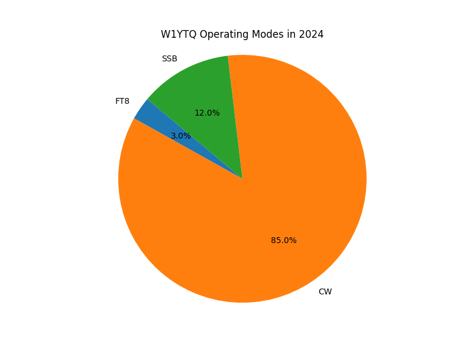
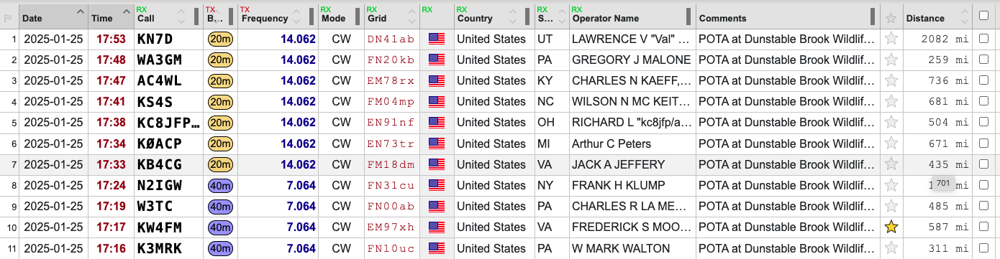
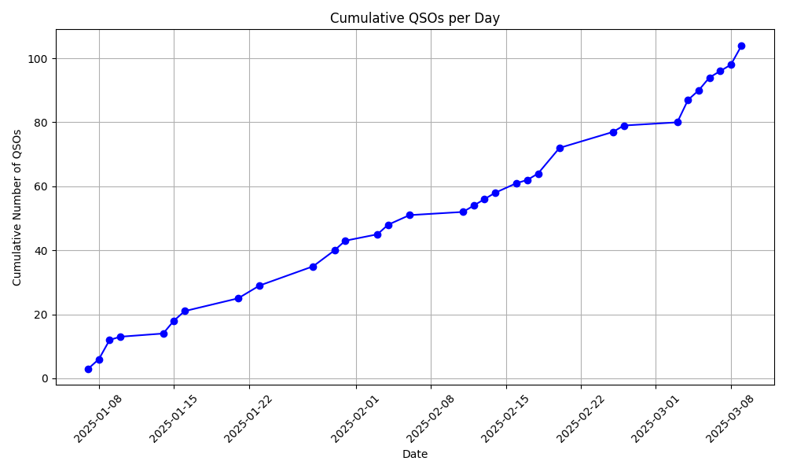

# ham-radio-utils

Personal tooling used by W1YTQ for amateur radio logs in [ADIF](https://adif.org/) format. It does three jobs:

1. **Paper log to ADIF.** Turn a photo of a handwritten log (usually a POTA activation) into a validated, QRZ-enriched
   `.adi` file ready to import into HAMRS, QRZ, LoTW or POTA. See [Paper log to ADIF](#paper-log-to-adif).
2. **Filter and analyze existing logs.** Tag every QSO with a comment, pull out SKCC contacts, and chart modes, top
   callsigns and QSOs per day. See [`process-adif.py`](#processing-and-analyzing-adif-files).
3. **Small side tools.** A CW frequency chart and a Wavelog setup. See [Other contents](#other-contents).

## What is in the repo

| Path | Purpose |
|---|---|
| `build-adif.py` | Builds an ADIF file from a session JSON (date, frequency, optional park, QSO list). Computes every length prefix, so the output is spec-conformant. `park` is optional: leave it out for non-POTA logs. |
| `enrich-adif.py` | Fills empty fields (name, city, state, county, grid, country) from the QRZ.com XML API and, for park-to-park contacts, from the POTA API. Never overwrites a logged value; disagreements are reported. Dry run by default, `--apply` writes. |
| `process-adif.py` | Analysis and filtering commands: `comment`, `skcc`, `modedist`, `top10calls`, `perday`, `columns`. |
| `.claude/skills/photo-to-adif/SKILL.md` | The Claude Code skill that drives the paper-log workflow: transcription rules, callsign verification, enrichment and validation. |
| `with-qrz.sh` | Optional wrapper that runs a command with the QRZ credentials read from a LastPass note instead of `.env`. Not needed otherwise. |
| `docs/qrz-xml-interface-spec.md` | Local copy of the QRZ XML interface specification, used by `enrich-adif.py`. |
| `cw-frequencies/` | Static D3.js chart of CW usage on 20 meters (see its README). |
| `docker-compose.yml`, `Caddyfile`, `connect.sh` | Personal [Wavelog](https://github.com/wavelog/wavelog) experiment: database and app containers, a Caddy reverse proxy, and a script that starts `flrig` and a Wavelog gateway. |
| `lofi_kbos.sh` | Writes a `.m3u` playlist of lo-fi streams for background listening while operating. Currently broken (see below). |
| `requirements.txt`, `pyproject.toml` | Python dependencies (`pyproject.toml` is the source, `requirements.txt` is generated). |

Exported logs (`*.adi`, `*.adif`), QRZ and POTA lookup caches and `.env` are gitignored. The `.adi` files you see in a
working copy are local data, not part of the repository.

## Paper log to ADIF

The workflow is a Claude Code skill (`photo-to-adif`) plus the two deterministic scripts above. Claude reads the
photo and makes the judgement calls; the scripts do the byte-exact work.

1. **Transcribe.** The page is read into a session JSON. Callsigns with no time are excluded, struck entries are
   deleted, frequency carries forward, and ambiguous calls are checked with the operator rather than guessed. Calls
   are cross-checked against QRZ, earlier logs, and spot or hunter-log evidence when available.
2. **Build.** `./build-adif.py session.json -o "Park-Name---US-0000,-Month-D,-YYYY.adi"`
3. **Enrich.** `./enrich-adif.py file.adi` for a dry run, then `--apply`.
4. **Comment.** `./process-adif.py comment --comment "POTA @ Park Name" file.adi` writes a `.comments.adi` sibling.
5. **Validate.** Check that every field length matches its value and the record count matches the page.

Session JSON shape:

```json
{
  "date": "20261024",
  "freq": "14.044",
  "mode": "SSB",
  "park": "US-0745",
  "my_gridsquare": "FN42fo",
  "qsos": [
    {"time": "1500", "call": "K4HNH", "their_park": ["US-0161", "US-3791"]},
    {"time": "1505", "call": "DF7A", "freq": "21.340", "country": "GERMANY", "dxcc": "230"}
  ]
}
```

- **Defaults** (top of `build-adif.py`): operator W1YTQ, `MY_STATE` MA, mode CW, 20 W, RST 599, country USA (DXCC 291).
  Override any of them in the session JSON; DX contacts need `country` and `dxcc`.
- **POTA.** With `park`, each record gets `MY_POTA_REF`, `MY_SIG` and `MY_SIG_INFO`. A contact made by a station that
  was itself in a park carries `their_park` (`SIG`/`SIG_INFO`); a list is written comma-separated for a multi-park
  activator. The enrichment step then uses the park's grid and state instead of the operator's home data.
- **Non-POTA logs.** Leave `park` out and the file has no `MY_POTA_REF`, `MY_SIG` or `MY_SIG_INFO`.
- **Travel.** If a station's logged state disagrees with QRZ, the logged state is kept and QRZ's city, county and grid
  are skipped, because they describe the wrong place.
- **Encoding.** Files are read and written as ISO-8859-1 so length prefixes stay correct for accented names.
- **Station grid.** `my_gridsquare` must match the station locator configured in HAMRS, or HAMRS skips the QSOs on import
  with "Differing locator".

### QRZ setup

`enrich-adif.py` needs an active QRZ XML subscription. Put credentials in `.env` (gitignored):

```
qrz_username=W1YTQ   # your QRZ.com callsign, not an email address
qrz_password=...
```

Lookups are cached in `.qrz-cache.json` and park lookups in `.pota-cache.json`.

#### Optional: keep the credentials in LastPass

Nothing requires this. `.env` or plain environment variables work on their own. If you keep the credentials in
LastPass, `with-qrz.sh` runs any command with them loaded and never writes them to disk:

```bash
brew install lastpass-cli && lpass login you@example.com
# a secure note named ham-radio-utils/qrz whose body is the same KEY=value lines as .env
lpass add --notes --non-interactive "ham-radio-utils/qrz" < .env

./with-qrz.sh ./enrich-adif.py "file.adi" --apply
```

Set `QRZ_LPASS_NOTE` to use a different note name. Quote any value that contains spaces, `$` or `#`.

## Processing and analyzing ADIF files

`process-adif.py` takes a command and an ADIF file: `./process-adif.py <command> <file.adi>`.


### View radio modes

        % ./process-adif.py modedist combined.adi



### Report top 10 call signs in your log

```bash
 % ./process-adif.py top10calls combined.adi
Top 10 CALL entries:
shape: (10, 2)
┌────────┬───────┐
│ CALL   ┆ count │
│ ---    ┆ ---   │
│ str    ┆ u32   │
╞════════╪═══════╡
│ AB9CA  ┆ 10    │
│ WB0RLJ ┆ 8     │
│ W4SK   ┆ 7     │
│ NS1C   ┆ 6     │
│ W8NWG  ┆ 6     │
│ W5ATJ  ┆ 5     │
│ WD5EEI ┆ 5     │
│ KS4S   ┆ 5     │
│ N2QW   ┆ 5     │
│ W9VI   ┆ 5     │
└────────┴───────┘

```

### SKCC Filter

Creates a new adi file selecting only the QSOs that have "SKCC" in the comments attribute. I use this to turn a general
QRZ adi export into an adi file containing only my SKCC contacts. I then import that filtered file into [SKCC's](https://www.skccgroup.com/)
logging software.

The command below creates a new adi file with an `skcc.adi` suffix that is a subset of the provided file. The new file
will only have SKCC QSO records which are identified because their 'comments' attribute contains the string 'skcc' or 'SKCC'.

```bash
% ./process-adif.py skcc w1ytq.349397.20250114172534.adi
% ls -alt w1ytq.349397.20250114172534*
-rw-r--r--@ 1 cfarnham  staff  14741 Jan 14 17:08 w1ytq.349397.20250114172534.skcc.adi
-rw-r--r--@ 1 cfarnham  staff  14741 Jan 14 16:56 w1ytq.349397.20250114172534.adi
```

You can also add the SKCC keytype like this:

```bash
./process-adif.py skcc --key=SK w1ytq.349397.20250117205912.adi
```

This will add the `APP_SKCCLOGGER_KEYTYPE` value used by the SKCC Logger for awards.


### Add a comment to every QSO in the ADIF file

Creates a new adi file with the comment updated with a given value.

```bash
% ./process-adif.py comment --comment="POTA at Dunstable Brook Wildlife Refuge, US-11590" \
    ./Dunstable-Brook-Wildlife-Refuge,-January-25,-2025.adi
```
The command above will create a new file with a similar name like this `Dunstable-Brook-Wildlife-Refuge,-January-25,-2025.comments.adi` where
each record will contain the provided comment.

The above example created logs that look like the pic below.



### Cumulative QSOs per day

Creates a graph of cumulative QSOs per day.

```bash
% ./process-adif.py perday W1YTQ-20250310-1338.skcc.adi
```



### Display adif columns available for analysis

This is to aid in writing new features or functions by displaying the values
available for retrieval and analysis in your adi file.

```bash
    % ./process-adif.py columns w1ytq.349397.20250114172534.adi

    ['QSO_DATE', 'TIME_ON', 'CALL', 'FREQ', 'MODE', 'APP_QRZLOG_LOGID', 'APP_QRZLOG_QSLDATE',
    'APP_QRZLOG_STATUS', 'BAND', 'BAND_RX', 'CNTY', 'COMMENT', 'CONT', 'COUNTRY', 'CQZ',
    'DISTANCE', 'DXCC', 'EMAIL', 'EQSL_QSL_RCVD', 'EQSL_QSL_SENT', 'FREQ_RX', 'GRIDSQUARE',
    'ITUZ', 'LAT', 'LON', 'LOTW_QSLRDATE', 'LOTW_QSLSDATE', 'LOTW_QSL_RCVD', 'LOTW_QSL_SENT',
    'MY_CITY', 'MY_CNTY', 'MY_COUNTRY', 'MY_CQ_ZONE', 'MY_GRIDSQUARE', 'MY_ITU_ZONE', 'MY_LAT',
    'MY_LON', 'MY_NAME', 'MY_STATE', 'NAME', 'QRZCOM_QSO_DOWNLOAD_DATE',
    'QRZCOM_QSO_DOWNLOAD_STATUS', 'QRZCOM_QSO_UPLOAD_DATE', 'QRZCOM_QSO_UPLOAD_STATUS',
    'QSL_RCVD', 'QSL_SENT', 'QSL_VIA', 'QSO_DATE_OFF', 'QTH', 'STATE', 'STATION_CALLSIGN',
    'TIME_OFF', 'TX_PWR']
```

## How to install

Ensure you have Python 3 installed, preferably in a virtual environment created with a tool like `pyenv`.

Then run `pip install -r requirements.txt`

## For developers

### Manage dependencies

First update `pyproject.toml` and use `pip-tools` to generate an updated `requirements.txt`.

Only maintainers need to do this in cases where we want to manage dependencies.

Install pip-tools

    pip install pip-tools

Make sure that pyproject.toml has the libraries you want and then type:

    pip-compile


## Other contents

### `cw-frequencies/`

A static page that charts where CW activity sits on 20 meters, drawn with D3.js. Serve it with
`python3 -m http.server 8003` from that directory.

### `lofi_kbos.sh`

Regenerates `lofiyt.m3u`, a playlist of lo-fi streams (gitignored), adapted from
[lofiatc.sh](https://github.com/phazus/lofiatc.sh).

**Currently broken:** the lo-fi streams changed their access policies, so the playlist no longer plays. A fix is
planned.

## Errata

### What's up with the `docker-compose.yml` file?

It's just a personal experiment in setting up [Wavelog](https://github.com/wavelog/wavelog) and I didn't know where else to save it. Ignore it
or if it helps you use and learn more about Wavelog then please use it.
