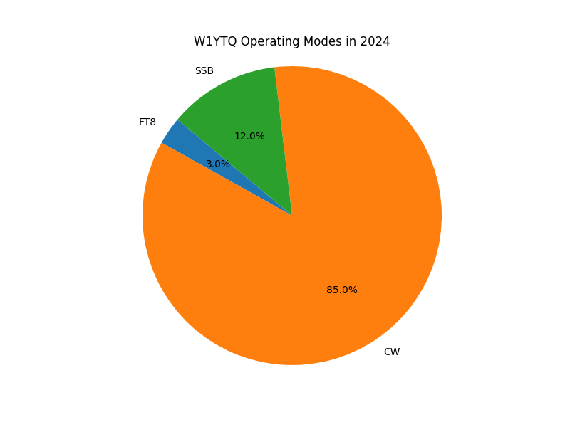
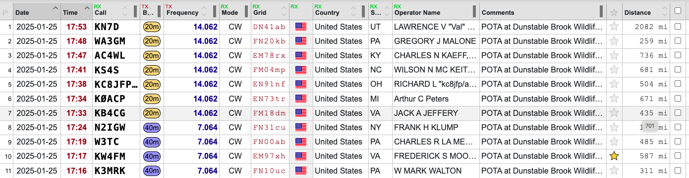

# ham-radio-utils

Personal tool developed and used by W1YTQ to filter and generate statistics from radio logging exports in adif format.

### View radio modes

        % ./process-adif.py modedist combined.adi



### Report top 10 call signs in your log

```bash
 % ./process-adif.py top10calls combined.adi
Top 10 CALL entries:
shape: (10, 2)
┌────────┬───────┐
│ CALL   ┆ count │
│ ---    ┆ ---   │
│ str    ┆ u32   │
╞════════╪═══════╡
│ AB9CA  ┆ 10    │
│ WB0RLJ ┆ 8     │
│ W4SK   ┆ 7     │
│ NS1C   ┆ 6     │
│ W8NWG  ┆ 6     │
│ W5ATJ  ┆ 5     │
│ WD5EEI ┆ 5     │
│ KS4S   ┆ 5     │
│ N2QW   ┆ 5     │
│ W9VI   ┆ 5     │
└────────┴───────┘

```

### SKCC Filter

Creates a new adi file selecting only the QSOs that have "SKCC" in the comments attribute. I use this to turn a general
QRZ adi export into an adi file containing only my SKCC contacts. I then import that filtered file into [SKCC's](https://www.skccgroup.com/)
logging software.

The command below creates a new adi file with an `skcc.adi` suffix that is a subset of the provided file. The new file
will only have SKCC QSO records which are identified because their 'comments' attribute contains the string 'skcc' or 'SKCC'.

```bash
% ./process-adif.py skcc w1ytq.349397.20250114172534.adi
% ls -alt w1ytq.349397.20250114172534*
-rw-r--r--@ 1 cfarnham  staff  14741 Jan 14 17:08 w1ytq.349397.20250114172534.skcc.adi
-rw-r--r--@ 1 cfarnham  staff  14741 Jan 14 16:56 w1ytq.349397.20250114172534.adi
```

You can also add the SKCC keytype like this:

```bash
./process-adif.py skcc --key=SK w1ytq.349397.20250117205912.adi
```

This will add the `APP_SKCCLOGGER_KEYTYPE` value used by the SKCC Logger for awards.


### Add a comment to every QSO in the ADIF file

Creates a new adi file with the comment updated with a given value.

```bash
% ./process-adif.py comment --comment="POTA at Dunstable Brook Wildlife Refuge, US-11590" \
    ./Dunstable-Brook-Wildlife-Refuge,-January-25,-2025.adi
```
The command above will create a new file with a similar name like this `Dunstable-Brook-Wildlife-Refuge,-January-25,-2025.comments.adi` where
each record will contain the provided comment.

The above example created logs that look like the pic below.



### Display adif columns available for analysis

This is to aid in writing new features or functions by displaying the values
available for retrieval and analysis in your adi file.

```bash
    % ./process-adif.py columns w1ytq.349397.20250114172534.adi

    ['QSO_DATE', 'TIME_ON', 'CALL', 'FREQ', 'MODE', 'APP_QRZLOG_LOGID', 'APP_QRZLOG_QSLDATE',
    'APP_QRZLOG_STATUS', 'BAND', 'BAND_RX', 'CNTY', 'COMMENT', 'CONT', 'COUNTRY', 'CQZ',
    'DISTANCE', 'DXCC', 'EMAIL', 'EQSL_QSL_RCVD', 'EQSL_QSL_SENT', 'FREQ_RX', 'GRIDSQUARE',
    'ITUZ', 'LAT', 'LON', 'LOTW_QSLRDATE', 'LOTW_QSLSDATE', 'LOTW_QSL_RCVD', 'LOTW_QSL_SENT',
    'MY_CITY', 'MY_CNTY', 'MY_COUNTRY', 'MY_CQ_ZONE', 'MY_GRIDSQUARE', 'MY_ITU_ZONE', 'MY_LAT',
    'MY_LON', 'MY_NAME', 'MY_STATE', 'NAME', 'QRZCOM_QSO_DOWNLOAD_DATE',
    'QRZCOM_QSO_DOWNLOAD_STATUS', 'QRZCOM_QSO_UPLOAD_DATE', 'QRZCOM_QSO_UPLOAD_STATUS',
    'QSL_RCVD', 'QSL_SENT', 'QSL_VIA', 'QSO_DATE_OFF', 'QTH', 'STATE', 'STATION_CALLSIGN',
    'TIME_OFF', 'TX_PWR']
```

## How to install

Ensure you have Python 3 installed, preferably in a virtual environment created with a tool like `pyenv`.

Then run `pip install -r requirements.txt`

## For developers

### Manage dependencies

First update `pyproject.toml` and use `pip-tools` to generate an updated `requirements.txt`.

Only maintainers need to do this in cases where we want to manage dependencies.

Install pip-tools

    pip install pip-tools

Make sure that pyproject.toml has the libraries you want and then type:

    pip-compile


## Errata

### What's up with the `docker-compose.yml` file?

It's my personal setup for [Wavelog](https://github.com/wavelog/wavelog), and I didn't know where else to save it. Ignore it,
or use it if it helps you learn Wavelog. See [Wavelog setup](#wavelog-setup) below.

## Wavelog setup

`docker-compose.yml` runs Wavelog rootless with podman and `podman-compose`, on the host `chris-radio-station`.

| Container       | Purpose                                       | Host port |
|-----------------|-----------------------------------------------|-----------|
| `wavelog-main`  | Wavelog (Apache + PHP)                        | `8086`    |
| `wavelog-db`    | MariaDB for Wavelog                           | none      |
| `reverse-proxy` | Caddy; `https://localhost` → `wavelog-main`   | `443`, `2019` (admin) |

### Start it, and start it on boot

```bash
podman-compose up -d

# start the stack at login/boot via a systemd user unit
podman-compose systemd -a register
systemctl --user enable --now podman-compose@ham-radio-utils
```

### URLs

- `http://chris-radio-station.local:8086/`: the main URL, works on the LAN over mDNS.
- `http://<LAN-IP>:8086/`, or `http://<tailscale-IP>:8086/` from other tailnet devices (phones often can't resolve `.local`).
- `https://localhost/`: through Caddy, on this machine only. Trust `certificate-authority/intermediate.crt` first
  (see the comments in `docker-compose.yml`).

### `base_url` (configured in the volume, not in compose)

Wavelog redirects every request to its `base_url`. If that host doesn't resolve for the browser, the page fails to load,
even though port 8086 is working. The setting lives in
`application/config/docker/config.php` inside the `ham-radio-utils_wavelog-config` volume:

```bash
~/.local/share/containers/storage/volumes/ham-radio-utils_wavelog-config/_data/config.php
```

This file is owned by the container's user, so edit it with `podman unshare` (for example `podman unshare vi <path>`).
It's plain PHP, so it follows whichever allowed host the browser used and falls back to a fixed one. Unknown `Host`
headers are never used in links:

```php
// Follow the host the browser used, if it's one we trust; else fall back to the Tailscale IP.
$wl_allowed_hosts = array('chris-radio-station.local', 'chris-radio-station', '<LAN-IP>', '<tailscale-IP>', 'localhost', '127.0.0.1');
$wl_host = isset($_SERVER['HTTP_HOST']) ? strtolower(preg_replace('/:\d+$/', '', $_SERVER['HTTP_HOST'])) : '';
// Requests arriving via the Caddy HTTPS proxy carry X-Forwarded-Proto: https; link back over HTTPS (port 443).
$wl_https = isset($_SERVER['HTTP_X_FORWARDED_PROTO']) && strtolower($_SERVER['HTTP_X_FORWARDED_PROTO']) === 'https';
$wl_prefix = $wl_https ? 'https://' : 'http://';
$wl_suffix = $wl_https ? '/' : ':8086/';
$config['base_url'] = in_array($wl_host, $wl_allowed_hosts, true)
	? $wl_prefix . $wl_host . $wl_suffix
	: $wl_prefix . '<tailscale-IP>' . $wl_suffix;
```

Without the `X-Forwarded-Proto` check, every HTTPS request through Caddy gets redirected back to `http://<host>:8086/`.

The change takes effect on the next request, with no restart needed. If you change the published port in
`docker-compose.yml`, update `:8086` here as well.

### mDNS (`.local`) name: avahi config

On Wi-Fi with IPv6, avahi sometimes mistakes its own announcement for another device at boot and renames the host.
The log shows `Host name conflict, retrying with chris-radio-station-2`, and after that `chris-radio-station.local`
stops resolving. The host's lookups only use IPv4 mDNS (`mdns4_minimal` in `/etc/nsswitch.conf`), so I limit avahi to IPv4
on the Wi-Fi interface in `/etc/avahi/avahi-daemon.conf`:

```ini
[server]
use-ipv6=no
allow-interfaces=wlp3s0
```

```bash
sudo systemctl restart avahi-daemon
getent ahostsv4 chris-radio-station.local   # should print the LAN IP
journalctl -u avahi-daemon -b | grep "Host name is"
```

### Troubleshooting "can't connect on 8086"

1. Check the port itself: `curl -sI http://127.0.0.1:8086/` should return `307` with a `Location:` header.
2. If it does, the `Location` host is the problem. Check it resolves: `getent ahostsv4 <host>`.
3. Check for an avahi rename: `journalctl -u avahi-daemon -b | grep -i conflict`.
